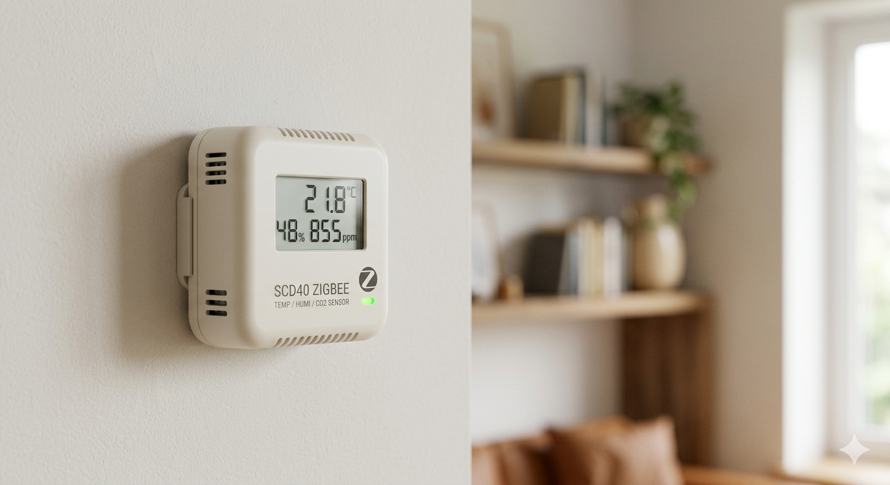

# Capteur CO2 / température / humidité Zigbee — XIAO ESP32-C6 + SCD40



Firmware Arduino pour un Seeed XIAO ESP32-C6 + Sensirion SCD40, en Zigbee (end device), pour Zigbee2MQTT.

- Température + humidité (endpoint 10) et CO2 (endpoint 11), envoyés toutes les 30 s
- Calibrage automatique du CO2 (ASC, 400 ppm) et offset de température réglable (`TEMP_OFFSET_C`)
- Bouton d'appairage (D1 → GND), LED de statut (GPIO15)
- Mise à jour OTA par le réseau Zigbee, publiée automatiquement par GitHub Actions

## Câblage

| SCD40 | XIAO ESP32-C6 |
|---|---|
| VDD | 3V3 |
| GND | GND |
| SDA | D4 (GPIO22) |
| SCL | D5 (GPIO23) |
| Bouton d'appairage | D1 (GPIO1) → GND |

## Compilation (Arduino IDE)

- Core **esp32 by Espressif** ≥ 3.3, librairie **Sensirion I2C SCD4x**
- Outils → Carte : `XIAO_ESP32C6`
- Outils → Zigbee mode : `Zigbee ED (end device)`
- Outils → Partition Scheme : `Zigbee 4MB with spiffs`

`i2c_scanner/` : petit sketch de diagnostic (le SCD40 doit répondre en `0x62`).

## Zigbee2MQTT

1. Copier `z2m_converter.js` dans `external_converters/` (à côté de `configuration.yaml`)
2. Dans `configuration.yaml` :
   ```yaml
   advanced:
     enable_external_js: true
   ota:
     zigbee_ota_override_index_location: https://raw.githubusercontent.com/Flo69au/capteur-temp-rature-scd40_zigbee/main/ota_index.json
   ```
3. Redémarrer Zigbee2MQTT

## Publier une mise à jour OTA

1. Commit + push des modifications du sketch
2. Créer et pousser un tag **`v<entier>`** plus grand que le précédent (`v2`, `v3`, …) — le capteur flashé en USB est en version 1
3. Le workflow `.github/workflows/ota-release.yml` compile avec `OTA_FW_VERSION = <entier>`,
   crée l'image `.zigbee`, la publie dans une Release et met à jour `ota_index.json`
4. Dans Zigbee2MQTT : capteur → OTA → *Check for updates* → *Update*

Pas de `"force": true` dans l'index : la mise à jour serait proposée en boucle.
